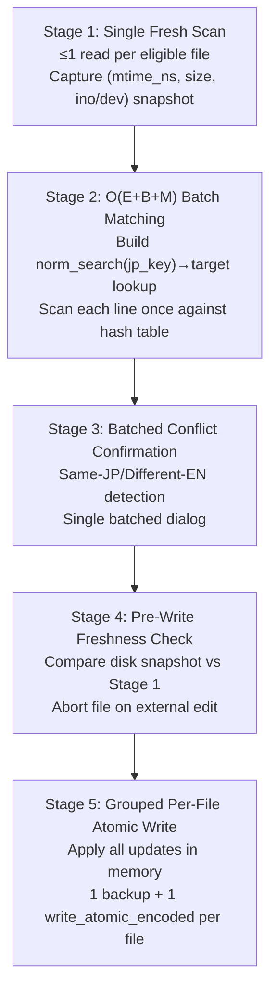

# S11b2 (v1.4.12) — Implementation Plan
## Bounded Single-Pass Batched XUAT Sync & Strict `Translation\en\Text` Alignment (`Q-02b`)

---

## 0. Pre-Session Snapshot

| Item | Value |
|---|---|
| **Branch** | `main` |
| **HEAD** | `66391718cfa55a45b108cb1235d3f53b73b75e9a` |
| **Python** | `3.12.10` |
| **`__version__`** | `"1.4.11"` (confirmed in [\_\_init\_\_.py](file:///D:/Misora-Editor/__init__.py)) |
| **`git status --short`** | `M CHANGELOG.md`, `M PROJECT_STATE.md`, `M assets/icons/BoxInsert.png`, `M misora.py`, `M tests/test_v15_s11b_scanner_save_preview.py`, `?? assets/icons/BoxReplace.png` |

> [!NOTE]
> `misora.py` and `CHANGELOG.md` show `M` from prior S11b session closure — these are the **pre-existing local modifications** to be preserved per `misora-safety.md` §2.

---

## 1. Root-Cause Analysis — The >60s 20-Box Save Hang

### Current O(B × F) Architecture (lines [13362–13431](file:///D:/Misora-Editor/misora.py#L13362-L13431))

```
for each modified box B:                        # B iterations
    preview_matches(jp_key, search_roots)        # → rglob("*.txt") → reads ALL eligible files
    find_and_update(jp_key, ..., search_roots)   # → rglob("*.txt") → reads + writes ALL eligible files
```

Each call to `preview_matches()` and `find_and_update()` (lines [113–172](file:///D:/Misora-Editor/core/xunity_sync.py#L113-L172) and [174–256](file:///D:/Misora-Editor/core/xunity_sync.py#L174-L256)) internally runs `root.rglob("*.txt")` which walks the **entire** `Translation\en\Text` tree per box.

**For 20 modified boxes on a 1,815-file tree:**
- File discovery: `20 × 2 × rglob(1815)` = 72,600 directory traversals
- File reads: `20 × 2 × 1815` = 72,600 file decode operations
- File writes: up to `20 × M` atomic writes (each hitting the same 3 target files redundantly)

**Profiling evidence (S11b `Q-02`):** Stage 3 `_sync_modified_boxes_to_xuat` = `93.725 ms` / `97.4%` of total `Ctrl+Shift+S` time with only **6** modified boxes and **10** XUAT files. Extrapolating: 20 boxes × 1,815 files ≈ 60s+ hang.

### Additional Issues Discovered During Inspection

1. **Divergent exclusion rules in `xunity_sync.py` vs `xuat_index.py`:**
   - `xunity_sync.py` line [136](file:///D:/Misora-Editor/core/xunity_sync.py#L136): `"_SUMMARY.txt"` (uppercase) — does NOT match `_summary.txt` (lowercase real files)
   - `xunity_sync.py` line [136](file:///D:/Misora-Editor/core/xunity_sync.py#L136): missing `.font.txt`, `.resizer.txt`, `postprocessors.txt`, `preprocessors.txt`, `substitutions.txt` and `.bak_` exclusions
   - `xuat_index.py` line [32–42](file:///D:/Misora-Editor/core/xuat_index.py#L32-L42): has the **correct** `_EXCLUDED_FILE_TAILS` + `.bak_` check in `_is_excluded_xuat_file()`

2. **No `Translation\en\Text` boundary enforcement in `xunity_sync.py`:** `preview_matches` and `find_and_update` accept arbitrary `search_roots` and do `rglob("*.txt")` without validating that roots are canonical `Translation\en\Text`. While `misora.py` passes `self.xuat_search_roots` (which came from `_resolve_xuat_text_root`), the sync manager itself has zero enforcement.

3. **Per-box conflict dialog spam:** Each box triggers its own `messagebox.askyesno()` call (line [13418](file:///D:/Misora-Editor/misora.py#L13418)), potentially showing 20 sequential modal dialogs during a single save.

4. **No same-JP conflict detection:** If two modified boxes in the same save share the same `norm_search(jp_key)` but have different English translations, iteration order silently picks the winner.

---

## 2. Architectural Design — 5-Stage O(E + B + M) Batched Sync

### Complexity Target

| Symbol | Meaning | Typical |
|---|---|---|
| E | Total dictionary lines read across all eligible files | ~200,000 |
| B | Modified boxes in this save | 1–50 |
| M | Matched `(file, line)` pairs found | 1–100 |
| F | Eligible `.txt` files in `Translation\en\Text` | ~1,815 |

**Current:** O(B × F × avg_lines) per save → ~72,600 file reads for 20 boxes.
**Target:** O(F + E + B + M) per save → ≤1,815 file reads + 1 hash build + ≤3 file writes.

### Stage-by-Stage Architecture



### Read-Count Strategy & Freshness Check Design

**Primary**: `(st_mtime_ns, st_size)` metadata snapshot per file, captured at Stage 1 scan time.

**Honest limits**: Metadata-only is NOT an absolute guarantee against crafted same-timestamp/same-size edits (e.g., a process writing exactly the same number of bytes within the same nanosecond). However, for the XUAT save-sync use case (where the gap between scan and write is typically <100ms and external edits are rare human actions), `(mtime_ns, size)` provides sufficient protection without the O(E) cost of a content hash. The pre-write check will additionally verify `st_ino`/`st_dev` on platforms that support it (Windows NTFS provides stable `st_ino` via `BY_HANDLE_FILE_INFORMATION`).

**Fallback**: If the metadata check detects a change, the entire file is aborted (not re-read). This is safe because stale writes are strictly worse than skipped writes.

---

## 3. Detailed Symbol-Bound Implementation

### 3.1. `core/xunity_sync.py` Changes

#### New Data Structures

```python
@dataclass
class BatchSyncTarget:
    """A single modified box's sync request."""
    box_uid: Optional[int]
    jp_key: str           # immutable original JP key
    norm_key: str         # norm_search(jp_key)
    new_english: str      # box.clean_text
    box_index: int        # for reporting

@dataclass
class BatchMatchRecord:
    """A matched dictionary line for one target."""
    file_path: Path
    line_index: int       # 0-based index into decoded lines list
    raw_key: str
    old_value: str
    target: BatchSyncTarget

@dataclass
class FileSnapshot:
    """Captured file state at scan time."""
    decoded_text: str
    encoding: str
    has_bom: bool
    newline: Optional[str]
    mtime_ns: int
    size: int
    ino: int              # st_ino (0 if unavailable)
    dev: int              # st_dev (0 if unavailable)

@dataclass
class BatchSyncResult:
    """Granular per-box outcome reporting."""
    succeeded_uids: Set[int]
    conflict_skipped_uids: Set[int]
    freshness_failed_uids: Set[int]
    io_failed_uids: Set[int]
    synced_files: Set[str]
    total_lines_scanned: int
    files_scanned: int
    elapsed_seconds: float
```

#### New Method: `batch_sync()`

```python
def batch_sync(
    self,
    targets: List[BatchSyncTarget],
    search_roots: List[Path],
    backup: bool = True,
    backup_dir: Optional[Path] = None,
    conflict_callback: Optional[Callable] = None,  # DI from misora.py
    is_excluded_fn: Optional[Callable[[Path], bool]] = None,  # DI from xuat_index
) -> BatchSyncResult:
```

**Stage 1** — Single scan of `search_roots`:
- For each root, `os.walk()` once (not `rglob`)
- For each `.txt` file: check `is_excluded_fn(path)` (injected `_is_excluded_xuat_file`), skip if excluded
- Read raw bytes once, `detect_encoding_and_decode()`, capture `FileSnapshot` including `os.stat()` metadata
- Store decoded content in `_scanned_files: Dict[Path, FileSnapshot]`

**Stage 2** — O(E + B + M) hash matching:
- Build `_target_map: Dict[str, List[BatchSyncTarget]]` keyed by `norm_search(jp_key)` from all targets
- For each scanned file, iterate lines once: `split_xuat_line()` → `norm_search(k_part)` → lookup in `_target_map`
- Collect `List[BatchMatchRecord]` for each match

**Stage 3** — Conflict detection:
- **Same-JP/Different-EN**: Group targets by `norm_key`. If any `norm_key` maps to ≥2 targets with different `new_english`, mark all as `conflict_skipped`
- **Multi-file existing-translation conflict**: If a single `norm_key` matches lines in ≥2 files with different existing `old_value`, invoke `conflict_callback` once (batched)
- If `conflict_callback` returns `False`, mark those box UIDs as `conflict_skipped`

**Stage 4** — Pre-write freshness:
- For each file that has pending updates, `os.stat()` again
- Compare `(mtime_ns, size, ino, dev)` against `FileSnapshot`
- If changed: mark all targets for that file as `freshness_failed`

**Stage 5** — Grouped atomic write:
- Group remaining matches by `file_path`
- For each file: apply all line replacements in-memory, 1 backup, 1 `write_atomic_encoded()` call
- On I/O failure: mark all targets for that file as `io_failed`

#### Backward Compatibility

The existing `preview_matches()` and `find_and_update()` methods will be **preserved as-is** for any external callers (they are used in `test_p3_s10_xuat_integrity.py::test_probe_2`). No signatures change. No behavior changes in those methods.

### 3.2. `misora.py` Changes — `_sync_modified_boxes_to_xuat()` Rewrite

**Scope:** Lines [13362–13431](file:///D:/Misora-Editor/misora.py#L13362-L13431) — complete rewrite of this method body.

**Key changes:**
1. Build `List[BatchSyncTarget]` from `boxes_or_indices` using existing `_get_box_uid` + `orig_jp_map` + `sync_manager.get_jp_key()` resolution (preserving all existing JP key resolution logic)
2. Inject DI dependencies into `batch_sync()`:
   - `is_excluded_fn=_is_excluded_xuat_file` (imported from `core.xuat_index`)
   - `conflict_callback` wrapping a single batched `messagebox.askyesno()`
3. Use `time.perf_counter()` to measure sync duration, log as `[XUAT Sync] Synced N box(es) across M XUAT file(s) in X.XXXs (scanned K files)`
4. Process `BatchSyncResult`: remove only `succeeded_uids` from `_modified_boxes`; retain `conflict_skipped_uids` + `freshness_failed_uids` + `io_failed_uids`

**Return type change:** `Set[str]` → `Set[str]` (unchanged — synced file names). The granular retention is handled internally.

**On-save wiring** (lines [13547–13574](file:///D:/Misora-Editor/misora.py#L13547-L13574)):
- Replace unconditional `self._modified_boxes.clear()` (line [13567](file:///D:/Misora-Editor/misora.py#L13567)) with granular clearing based on `BatchSyncResult.succeeded_uids`
- Preserve the `except Exception as xuat_err:` secondary-failure tolerance (keeping primary save `True`/clean, retaining `_modified_boxes`)

### 3.3. `_resolve_xuat_text_root()` Alignment

**Current issue** (line [4067](file:///D:/Misora-Editor/misora.py#L4067)): `proj_dir / "Text"` and fallback `proj_dir` bypass the strict `Translation\en\Text` boundary.

**Fix:** Remove the `proj_dir / "Text"` candidate and the `proj_dir` fallback. Instead, delegate to `resolve_xuat_text_roots([proj_dir])` from `core.xuat_index` which already implements the strict 6-form canonical resolution. This ensures `self.xuat_search_roots` is always a strict `Translation\en\Text` root.

---

## 4. Test Migration Analysis

### Existing Tests Requiring Migration

| Test File | Affected Assertions | Migration Plan |
|---|---|---|
| [test_p3_s10_xuat_integrity.py](file:///D:/Misora-Editor/tests/test_p3_s10_xuat_integrity.py) | `test_probe_1` (line [104–265](file:///D:/Misora-Editor/tests/test_p3_s10_xuat_integrity.py#L104-L265)): Uses `self.app.xuat_search_roots = [xuat_dir]` where `xuat_dir` is a bare temp directory (not `Translation\en\Text`). The old per-box `preview_matches`/`find_and_update` accepted arbitrary roots, but `batch_sync` requires strict roots. | **Migration needed:** Restructure the synthetic tree to use `tmp_dir / "Translation" / "en" / "Text"` and set `xuat_search_roots` accordingly. The XUAT file content and assertions remain identical — only the directory structure changes. |
| [test_p3_s10_xuat_integrity.py](file:///D:/Misora-Editor/tests/test_p3_s10_xuat_integrity.py) | `test_probe_2` (line [266–314](file:///D:/Misora-Editor/tests/test_p3_s10_xuat_integrity.py#L266-L314)): Tests `XUnitySyncManager.find_and_update()` directly (not via `misora.py`). | **No migration needed.** `find_and_update()` is preserved as-is. The test calls it directly on `XUnitySyncManager`, passing `search_roots=[self.tmp_dir]` — this bypasses the batched path entirely. |
| [test_s2_dirty_contract.py](file:///D:/Misora-Editor/tests/test_s2_dirty_contract.py) | `test_07` (line [350–389](file:///D:/Misora-Editor/tests/test_s2_dirty_contract.py#L350-L389)): Mocks `self.app.sync_manager.find_and_update` to raise, asserts `on_save()` returns `True` and `_modified_boxes` retained. | **Migration needed:** The mock target changes from `sync_manager.find_and_update` to `sync_manager.batch_sync` (since `_sync_modified_boxes_to_xuat` will call `batch_sync` instead of `find_and_update`). The semantic assertion is identical: secondary XUAT failure → primary save `True` → `_modified_boxes` retained. This is an **equal-strength** migration. |
| [test_p3_s09_replace_all_backups.py](file:///D:/Misora-Editor/tests/test_p3_s09_replace_all_backups.py) | No XUAT sync patterns found. | **No migration needed.** |

> [!IMPORTANT]
> **Project Lead Approval Required:** Two existing test files need migration (declared above). Both migrations preserve equal-or-stronger assertion semantics:
> - `test_p3_s10_xuat_integrity::test_probe_1`: Directory structure change only (content/assertions identical)
> - `test_s2_dirty_contract::test_07`: Mock target change only (semantic assertion identical)

---

## 5. Anti-Circular-Import Strategy

### Current Import Graph

```
core/xunity_sync.py ──imports──→ core/story_ast.py (norm_search)
core/xunity_sync.py ──imports──→ core/text_encoding.py
core/xuat_index.py  ──imports──→ core/xunity_sync.py (split_xuat_line)
core/xuat_index.py  ──imports──→ core/story_ast.py
core/xuat_index.py  ──imports──→ core/ngui_tags.py
```

### S11b2 Strategy

`core/xunity_sync.py` **MUST NEVER** execute a top-level `from .xuat_index import ...` (would create a circular import since `xuat_index` already imports from `xunity_sync`).

**Dependency Injection approach:**
- `batch_sync()` accepts `is_excluded_fn: Optional[Callable[[Path], bool]] = None` parameter
- `misora.py` passes `is_excluded_fn=_is_excluded_xuat_file` (imported from `core.xuat_index`)
- If `is_excluded_fn` is `None` (direct unit-test callers), `batch_sync()` falls back to a minimal local exclusion using the same `_EXCLUDED_FILE_TAILS` tuple (defined locally in `xunity_sync.py` to match `xuat_index.py`'s values exactly)
- **Tested** in isolated subprocesses under BOTH import orders

> [!WARNING]
> The local `_EXCLUDED_FILE_TAILS` fallback in `xunity_sync.py` duplicates the constant from `xuat_index.py`. This is intentional to avoid circular imports. A comment in both files will cross-reference the other to prevent silent divergence.

---

## 6. `norm_search()` vs `normalize_xuat_key()` — Match-Semantics Proof

### Difference Analysis

| Property | `norm_search()` ([story_ast.py:130](file:///D:/Misora-Editor/core/story_ast.py#L130)) | `normalize_xuat_key()` ([xuat_index.py:113](file:///D:/Misora-Editor/core/xuat_index.py#L113)) |
|---|---|---|
| Unescape `\n`/`\=` | No | Yes (`unescape_xuat_key`) |
| Strip NGUI tags | No | Yes (via `strip_tags`) |
| Canonicalize `{playername}` | Via `game_to_xuat()` | Via sentinel protection |
| NFKC | Yes | Yes |
| Dash map | Yes | Yes |
| Whitespace collapse | `ALL_WS_RE.sub("")` | `ALL_WS_RE.sub("")` |
| Casefold | Yes | Yes |
| Multi-dash collapse | Yes | Yes |

**Key difference:** `normalize_xuat_key` strips NGUI tags and unescapes `\n`/`\=`. For XUAT sync matching, we use `norm_search()` on **both sides** (the box's JP key and the dictionary's raw key), which is the existing semantic.

**The parity test** will verify: given a set of synthetic keys containing NGUI tags, `{playername}`, `{0}`, fullwidth chars, escaped `\n`, and extra whitespace, the matched `(file, line)` set is **identical** between:
- Old path: per-box `preview_matches()` using `norm_search()`
- New path: batched `batch_sync()` using `norm_search()`

---

## 7. New Test File: `tests/test_v15_s11b2_xuat_batch_sync.py`

### Failing-First Structural Probes (MUST FAIL pre-patch, PASS post-patch)

| Test | Description | Key Assertions |
|---|---|---|
| `test_probe_1_strict_en_text_boundary_and_case_insensitive_exclusions` | Synthetic tree: `Translation\en\Text` (valid + all excluded types) + forbidden `en\Other`, `en\RedirectedResources`, `ja\Text`. Instruments file I/O. | Forbidden/excluded files: 0 reads, 0 writes. Exclusion parity with `_is_excluded_xuat_file`. |
| `test_probe_2_single_pass_batched_sync_structural_counts_and_20box_benchmark` | 100 synthetic `.txt` files, 20 modified boxes hitting 3 target files. Instruments traversals, reads, writes. | ≤1 traversal per save, each file read ≤1×, 3 target files get exactly 1 backup + 1 `write_atomic_encoded` each, 97 unaffected files get 0 writes. Prints wall-clock timing. |
| `test_probe_3_norm_search_parity_same_jp_conflict_freshness_and_partial_failure` | (a) Match-set parity test, (b) Same-JP/Different-EN conflict detection, (c) Between-scan-and-write freshness, (d) Partial file-write failure. | (a) Identical `(file, line)` sets. (b) Conflict detected, 0 silent overwrite, UIDs retained. (c) External edit not clobbered, UIDs retained. (d) File A/C boxes cleared, File B boxes retained, `on_save()` returns `True`. |

### Regression Guards (MUST PASS both pre-patch and post-patch)

| Test | Description | Key Assertions |
|---|---|---|
| `test_guard_1_pure_core_and_zero_circular_import_both_orders` | Isolated subprocess: import `core.xunity_sync` then `core.xuat_index`, and reverse. | 0 `ImportError`, 0 `tkinter`/`misora` imports in `core.xunity_sync`. |
| `test_guard_2_s10_immutable_jp_conflict_gate_and_s2_secondary_failure_tolerance` | Revalidates S10 conflict preview gate and S02 secondary-sync failure tolerance. | `on_save()` returns `True`, doc clean, failed `_modified_boxes` retained. |

---

## 8. File-by-File Change Summary

| File | Action | Scope |
|---|---|---|
| `__init__.py` | MODIFY | `"1.4.11"` → `"1.4.12"` |
| `core/xunity_sync.py` | MODIFY | Add `BatchSyncTarget`, `BatchMatchRecord`, `FileSnapshot`, `BatchSyncResult` dataclasses. Add `batch_sync()` method. Add local `_EXCLUDED_FILE_TAILS` fallback constant. Preserve existing `preview_matches()`, `find_and_update()`, `SyncMatch`, `split_xuat_line()`, `escape_xuat_value()` unchanged. |
| `misora.py` | MODIFY | Rewrite `_sync_modified_boxes_to_xuat()` body to build `BatchSyncTarget` list and call `batch_sync()`. Update on-save wiring for granular `_modified_boxes` clearing. Update `_resolve_xuat_text_root()` to remove bare `Text/` and `proj_dir` fallbacks (delegate to `resolve_xuat_text_roots`). Add `time.perf_counter()` telemetry. |
| `tests/test_v15_s11b2_xuat_batch_sync.py` | CREATE | 3 failing-first probes + 2 regression guards. |
| `tests/test_p3_s10_xuat_integrity.py` | MODIFY | `test_probe_1`: restructure synthetic XUAT tree to `Translation\en\Text` subdirectory. |
| `tests/test_s2_dirty_contract.py` | MODIFY | `test_07`: change mock target from `sync_manager.find_and_update` to `sync_manager.batch_sync`. |
| `CHANGELOG.md` | MODIFY | Add `### S11b2 (v1.4.12)` section. |
| `PROJECT_STATE.md` | MODIFY | Record S11b2 architecture, synthetic structural counts & timings, verification baseline. |

---

## 9. Verification Commands (Post-Patch)

```bash
# 1. Compile check
py -3.12 -m compileall -q __init__.py misora.py core assets tests

# 2. Targeted suites (S11b2 + dependent suites)
py -3.12 -m unittest tests.test_v15_s11b2_xuat_batch_sync tests.test_p3_s10_xuat_integrity tests.test_s2_dirty_contract tests.test_p3_s09_replace_all_backups tests.test_v15_s11b_scanner_save_preview tests.test_v15_s11_xuat_archiving_progress -v

# 3. Full discovery (0 new regressions)
py -3.12 -m unittest discover -s tests -v

# 4. Git status (only allowed files modified)
git status --short
```

---

## 10. Definition of Done

- [ ] All 3 probes FAIL pre-patch, PASS post-patch
- [ ] Both guards PASS pre-patch and post-patch
- [ ] `compileall` PASS (exit 0)
- [ ] All targeted suites PASS
- [ ] Full discovery: 0 new regressions vs S11b baseline (440 tests)
- [ ] `git status --short` shows only allowed S11b2 files modified + pre-existing `BoxInsert.png`/`BoxReplace.png`
- [ ] `CHANGELOG.md` updated with `### S11b2 (v1.4.12)`
- [ ] `PROJECT_STATE.md` updated with architecture, counts, timings, and manual QA item
- [ ] `__init__.py` reads `"1.4.12"`
- [ ] `[XUAT Sync]` telemetry logged with dedicated sync duration

---

## 11. HARD STOP Gate — Async Disk-I/O Boundary

Per PART 0 §3: If the single-pass O(E + B + M) batched sync still takes >2s on a synthetic 1,815-file benchmark (measured inside `test_probe_2`), this plan **STOPS** and spins off a separate `AGENTS.md` §15-safe async disk-I/O session.

**Expected:** With a single traversal and ≤1,815 file reads (mostly <10KB each), the scan phase should complete in <500ms. The batch matching and write phases are O(E + B + M) and negligible. Total expected sync time: <1s for 20 boxes on 1,815 files.

---

> [!IMPORTANT]
> **STOP — Awaiting explicit Project Lead `Proceed` before editing ANY file.**
>
> Please review:
> 1. The 5-stage O(E + B + M) architecture
> 2. The two test migrations declared in §4
> 3. The `_resolve_xuat_text_root()` tightening in §3.3
> 4. The DI exclusion strategy with local fallback constant (§5)
> 5. The `(mtime_ns, size, ino, dev)` freshness strategy and its honest limitations (§2)
