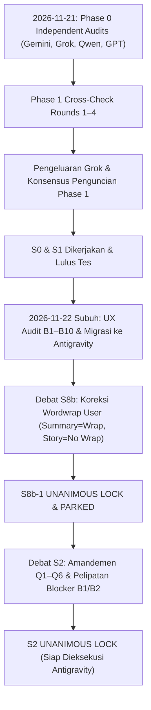

# MISORA EDITOR — MASTER SUMMARY & CONSENSUS LEDGER
## Notulen Eksekutif, Arsitektur, Registry Bug (F1–F20, B1–B10), dan Roadmap S0–S11

**Penyusun:** Asisten Sekretaris Pencatat (Google Antigravity AI)  
**Target Repositori Proyek:** `Misora-Editor` (`D:\Misora-Editor` | [GitHub: ImaterialC/Misora-Editor](https://github.com/ImaterialC/Misora-Editor))  
**Target Repositori Referensi:** `Reference-Files` (`d:\Reference\Reference Files` | [GitHub: ImaterialC/Reference-Files](https://github.com/ImaterialC/Reference-Files))  
**Tanggal Terakhir Diperbarui:** 2026-11-22

---

## 1. PENDAHULUAN & TUJUAN DOKUMEN

Dokumen ini adalah **ringkasan otoritatif bebas redundansi** dari seluruh perdebatan teknis lintas AI (GPT, Gemini, Qwen, dan User) dalam mengaudit, memperbaiki arsitektur, dan meningkatkan fitur **Misora Editor**.

Tujuan utama dokumen ini adalah memberikan pemahaman menyeluruh dalam satu berkas terstruktur, sehingga AI atau pengembang mana pun yang bergabung di tengah rapat dapat memahami konteks, keputusan yang telah dikunci (*locked*), dan langkah selanjutnya tanpa harus membaca ribuan baris rekaman obrolan mentah.

---

## 2. ARSITEKTUR MISORA EDITOR

Misora Editor adalah aplikasi desktop editor naskah cerita (*adv script*) untuk game **Princess Connect! Re:Dive** berbasis Python 3.12 dan Tkinter. Aplikasi ini memanipulasi file aset Unity (`.unity3d`), format teks NGUI bertag, serta sinkronisasi kamus terjemahan XUnity Auto Translator (XUAT).

### Peta Komponen Utama:
- **`misora.py`:** Titik masuk utama (*entrypoint*) dan pengendali antarmuka pengguna (GUI Tkinter), manajemen tab, ribbon toolbar, event keyboard/mouse, serta integrasi komponen inti.
- **`core/story_ast.py`:** Pemodelan AST (*Abstract Syntax Tree*) untuk naskah cerita (`StoryDocument`, `Box`, `CommandRecord`), serialisasi/deserialisasi naskah.
- **`core/bundle_io.py`:** Pembacaan dan pengemasan ulang aset `.unity3d` berbasis UnityPy / format biner aset.
- **`core/script_codec.py`:** Pengkodean dan pendekodean naskah cerita antara representasi teks dan biner AST.
- **`core/undo_journal.py`:** Mesin pencatat riwayat perubahan undo/redo berbasis operasi delta.
- **`core/ngui_tags.py`:** Parser dan penangan tag format NGUI (`[b]`, `[i]`, `[color]`, `<size>`, ruby text, dll.).
- **`core/mtl_engine.py`:** Mesin bantuan terjemahan mesin (MTL) asinkron.
- **`core/search_engine.py`:** Mesin pencarian teks dan regex melintasi kotak dialog dan berkas.
- **`core/xunity_sync.py`:** Sinkronisasi dua arah dengan berkas konfigurasi/kamus terjemahan XUnity.
- **`core/security.py`:** Sanitasi path file, pencegahan *path traversal*, dan validasi keamanan berkas.
- **`core/logger.py`:** Subsistem pencatatan log diagnostik aplikasi.
- **`tests/`:** Rangkaian tes regresi otomatis berbasis `unittest`.

---

## 3. PROTOKOL & ATURAN SIDANG MULTI-AI

Proyek ini menggunakan metode **Engineering Review Board** berbasis konsensus multi-model:

| Partisipan | Peran Utama | Tanggung Jawab Kritis |
| :--- | :--- | :--- |
| **GPT** | Arbiter Final | Memeriksa akar terdalam (*deepest inspection*), mengeluarkan vonis *LOCK*, dan menyusun kerangka draf prompt awal. |
| **Gemini** | Reviewer Teknis | Menjaga stabilitas Tkinter, mengaudit risiko UX, dan menyusun *sync briefs* antar AI. |
| **Qwen (Assistant A)** | Verifikator Sumber | Menguji kebenaran kode terhadap disk (*live code verification*), mereproduksi bug, dan memberikan koreksi presisi teknis. |
| **User** | Direktur & Pengambil Keputusan | Memutus arah desain produk, memvalidasi kenyamanan pengguna, dan menjadi penghubung (*relay*) antar model. |
| **Google Antigravity** | Coding Agent (Eksekutor) | Agen AI mandiri yang mengeksekusi prompt rekayasa perangkat lunak secara lokal di `D:\Misora-Editor` melalui mode `/plan` dan TDD. |
| *Grok* | *Dikeluarkan* | *Telah diberhentikan oleh User setelah Phase 1. Temuan awalnya tetap sah, namun tidak memiliki hak suara lagi.* |

### Aturan Komunikasi:
1. Komunikasi kepada **User** wajib menggunakan **Bahasa Indonesia**.
2. Komunikasi teknis, perdebatan antar-AI, draf instruksi, dan prompt coding wajib menggunakan **Bahasa Inggris**.
3. **Disiplin Konsensus:** Dilarang mengeksekusi kode sebelum ada konsensus bulat (*UNANIMOUS LOCK*) dari para AI dan persetujuan dari User.

---

## 4. REGISTRY BUG & TEMUAN KRITIS

### A. Phase 1 Technical Audit (Cacat Integritas Data & Sistem F1–F20)
- **F1 (Dirty Tracking Desync):** Flag `is_dirty` dan status pada `open_documents` tidak sinkron saat berpindah file. *(Diselesaikan di S2)*.
- **F2 (Inconsistent on_save Return):** `on_save()` mengembalikan `None` atau tidak menangkap exception sehingga pemanggil tidak dapat membedakan keberhasilan dan kegagalan. *(Diselesaikan di S2)*.
- **F3 (Undo-Storm):** Undo pada dokumen memicu refresh berulang ke widget lain dan memicu lag. *(Diselesaikan di S2)*.
- **F4 (Plain-Text Save Desync):** File teks biasa yang dibuka terkontaminasi atau salah simpan jika preview aktif. *(Dijadwalkan S3)*.
- **F5 (Close Document Abort Missing):** Menutup tab dokumen tidak mengonfirmasi pembatalan jika penyimpanan gagal. *(Dijadwalkan S3)*.
- **F6 (Structural Snapshot Integrity):** Operasi Cut/Paste/Delete Box merusak integritas urutan ID Box. *(Dijadwalkan S4)*.
- **F7 (Multi-File Replace All):** Replace all lintas file menulis langsung ke disk tanpa validasi rollback. *(Dijadwalkan S5)*.
- **F8 (Threading Race Condition):** Operasi pencarian dan MTL di thread latar belakang mengakses UI Tkinter tanpa `after()`. *(Dijadwalkan S6)*.
- **F9 (XUAT Secondary Error Wipe):** Gagal menulis kamus XUAT menghapus antrean kotak modifikasi. *(Diselesaikan di S2)*.
- **F10–F20:** Cacat batas NGUI, memori bocor pada tag Tcl, validasi encoding UTF-8 BOM, penanganan path Windows multibyte, dan pengerasan branch speaker laten.

### B. Phase 1b UX Audit (Temuan Pengujian Pengguna B1–B10)
- **B1 (Preview Mode Guard & Aesthetic):** Mode Preview (ikon mata `👁`) harus berstatus *read-only* agar markup NGUI tidak rusak, dilengkapi toast peringatan, dan berpenampilan menyerupai kotak dialog game. *(S8b-1)*.
- **B2 (Ribbon Grouping):** Mengelompokkan ikon Preview dengan Single/Continuous View dan Select Box secara monokromatis. *(S8b-2)*.
- **B3 (Continuous View NGUI):** Tombol format NGUI mati pada tampilan kontinu. *(S8)*.
- **B4 (Header Naming):** Mengganti header statis `"GAME VIEW"` menjadi dinamis mencerminkan mode aktif: *Dialogue Editor*, *Dialogue Preview*, atau *Story Editor*. *(Disetujui User)*.
- **B5 (Structured Tooltips):** Tooltip 1-tingkat yang kaya (Judul, Deskripsi Singkat, Contoh miring) tanpa timer ganda yang rumit. *(S8b-3)*.
- **B6 (Stale Line Number):** Nomor baris tidak memperbarui saat Enter, Delete, atau Paste multiline. *(S8)*.
- **B8 (Empty Paste Preview Bug):** Dialog pratinjau impor naskah dari clipboard kosong pada pola tertentu. *(S4)*.
- **B9 (Translation Soft-Lock):** Kunci proteksi teks dialog yang tetap memperbolehkan seleksi dan copy, namun memblokir ketikan dan IME Jepang. *(S8b-4)*.
- **B10 (Opened Files vs Open File):** Tab samping kiri sering disalahartikan sebagai tombol buka file; diperjelas dengan ikon/tombol `+` dan judul deskriptif. *(S9)*.
- **Speaker Pin (`📌`):** Mengubah fungsi tombol pin untuk mengunci/membuka perubahan speaker pada kotak aktif. *(S8b-2)*.

---

## 5. ROADMAP LENGKAP SLICE PROMPT (S0–S11)

| Slice | Fokus Utama | Status Saat Ini | Berkas Terkait |
| :---: | :--- | :---: | :--- |
| **S0** | Test Harness & Environment Isolation | **SELESAI & LULUS** | `tests/test_misora_core.py` |
| **S1** | Open File Safety & Multi-Document Isolation | **SELESAI & LULUS** | `tests/test_s1_open_file_safety.py` |
| **S2** | Minimum Per-Document Dirty Contract & `on_save() -> bool` | **UNANIMOUS LOCK** (Siap Eksekusi) | `prompts/S2_dirty_contract_final_locked.md` |
| **S3** | Inactive-Doc Save, Close-File Abort & Save-All on Exit | Menunggu S2 | Rencana S3 |
| **S4** | Structural Snapshot, Cut/Paste Integrity & Fix B8 | Menunggu S3 | Rencana S4 |
| **S5** | Multi-File Replace-All & BulkFileDelta Checkpoints | Menunggu S4 | Rencana S5 |
| **S6** | Background Threading Redesign (Search & MTL Async) | Menunggu S5 | Rencana S6 |
| **S7** | Full MasterUndoJournal Revisions & Speaker Hardening | Menunggu S6 | Rencana S7 |
| **S8** | Editor Core Polish (B3 Continuous View & B6 Line Numbers) | Menunggu S7 | Rencana S8 |
| **S8b-1** | Narrowed Game-Style Dialogue Box Preview (Preview Skin) | **LOCKED & PARKED** | `prompts/S8b-1_narrowed_dialogue_box.md` |
| **S8b-2** | Ribbon Cleanup & Speaker Pin Toggle (`📌`) | Menunggu S8 | Rencana S8b-2 |
| **S8b-3** | Rich 1-Tier Structured Tooltips | Menunggu S8 | Rencana S8b-3 |
| **S8b-4** | Translation Soft-Lock UX (Caret/Copy Active) | Menunggu S8 | Rencana S8b-4 |
| **S9** | Left Sidebar Workspace (Opened Files vs Project Nav B10) | Menunggu S8b | Rencana S9 |
| **S10** | XUnity Translator Sync Hardening | Menunggu S9 | Rencana S10 |
| **S11** | Final Integration Verification, Build & Packaging | Menunggu S10 | Rencana S11 |

---

## 6. KRONOLOGI KONSENSUS (2026-11-21 s/d 2026-11-22)

---

## 7. PANDUAN LANGKAH EKSEKUSI BERIKUTNYA
1. Pastikan hasil pekerjaan S0 dan S1 sudah di-commit secara lokal di `D:\Misora-Editor`.
2. Salin isi lengkap prompt dari `prompts/S2_dirty_contract_final_locked.md`.
3. Buka Google Antigravity di workspace `D:\Misora-Editor`, tempel prompt dengan `/plan`.
4. Periksa artefak **Implementation Plan** yang dihasilkan Antigravity (terutama klasifikasi `test_34` dan verifikasi serializer `StoryDocument`).
5. Jika rencana sesuai, tekan tombol **Proceed** untuk menjalankan implementasi berbasis TDD (11 kasus uji).
