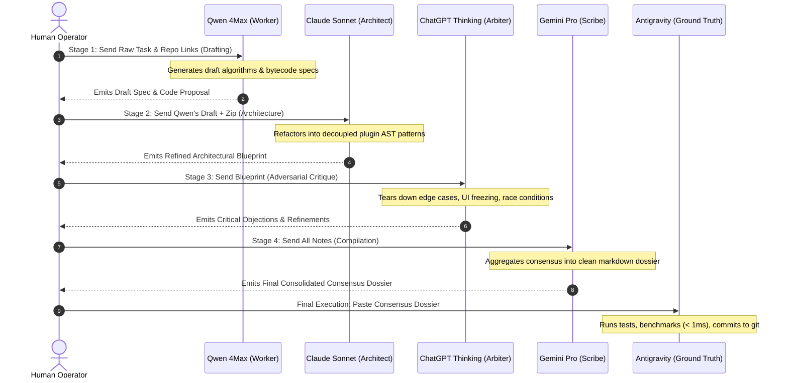

# Strategic Plan: Zero-Cost Multi-AI Council Optimization & Model Roster Blueprint

## Goal Description
To establish a battle-tested, zero-cost **Multi-AI Council Workflow** for the Misora Extractor Plugin project. This plan addresses the user's real-world setup—jumping across free and pro web accounts without expensive API subscriptions—by strategically matching each frontier model's cognitive traits, tool sandboxes, and rate limits to specific phases of reverse engineering and architecture.

---

## User Review Required

> [!IMPORTANT]
> **Key Finding on Multi-AI Psychology & Token Economy:**
> Your observation about model personalities is 100% accurate:
> 1. **ChatGPT Thinking (o1 / o3-mini / GPT-4o)** is the ultimate late-stage skeptic because its internal reasoning explicitly interrogates hidden assumptions, but free tokens are scarce.
> 2. **Gemini Pro (Carbon/Neon)** has a massive context window and handles zip uploads, but its reasoning often stops early; it is best used as a **Compiler/Synthesizer**, not a deep code detective.
> 3. **Qwen 4Max / Qwen-2.5-Coder** is the most generous and diligent worker in raw code analysis.
> 4. **Claude (Sonnet)** is the gold-standard code architect for AST/clean Python, but has strict hourly message limits on the free tier.
>
> We will formalize a **4-Stage Relay Protocol** so you never waste scarce high-reasoning tokens (ChatGPT/Claude) on initial low-level drafting.

---

## 1. Deep Research & Assessment of Each AI Model

### 1. [Free] ChatGPT (OpenAI - GPT-4o / o3-mini / o1-preview)
- **Actual Capabilities & Sandbox:**
  - Can fetch and read public GitHub repositories via its web browsing tool.
  - Thinking models (o1/o3-mini) generate hidden reasoning chains that excel at **adversarial review**: finding what others missed, identifying race conditions, and questioning architectural trade-offs.
- **Known Failure Mode:** Free quota for reasoning models is strictly rate-limited (e.g., 3–5 queries per few hours).
- **Optimal Council Role:** **The Late-Stage Skeptical Arbiter & Gatekeeper**.
  - *Strategy*: Do NOT use ChatGPT at the start. Bring it in only after Qwen and Claude have proposed a draft. Ask ChatGPT: *"Here is the consensus plan between Gemini, Claude, and Qwen. Tear it apart. What critical flaws, unhandled exceptions, or edge cases will cause this to fail in production?"*

---

### 2. [Pro] Gemini (Google - 2.0 Pro / Advanced "Carbon/Neon")
- **Actual Capabilities & Sandbox:**
  - Massive context window (1M–2M tokens) allowing full zip uploads and entire codebase dumps.
  - Very fast at compiling fragmented notes, writing comprehensive Markdown reports, and formatting documentation.
- **Known Failure Mode:** Tendency toward "sycophancy" (agreeing too quickly) and shallow reasoning cutoffs during complex binary reverse-engineering. It assumes code works without verifying bitwise nuances.
- **Optimal Council Role:** **The Chief Scribe & Document Compiler**.
  - *Strategy*: Use Gemini to ingest large reference zips (`v3_kyouka_suite`, legacy transcripts), generate formatted technical documentation, and summarize multi-page debate threads into clean executive briefs.

---

### 3. [Free] Qwen (Alibaba - Qwen-2.5-Coder / Qwen-Max)
- **Actual Capabilities & Sandbox:**
  - Qwen-2.5-Coder is widely recognized across open-source benchmarks (HumanEval, SWE-bench) as punching far above its weight, rivaling proprietary flagship models in raw code understanding.
  - Web version (Qwen Chat / Tongyi) has very generous free message limits, tireless reasoning, and great patience with dense bytecode logic.
- **Known Failure Mode:** Can occasionally produce slightly verbose boilerplate; less fluent in Western game community slang than ChatGPT.
- **Optimal Council Role:** **The Diligent First-Pass Engineer & Worker**.
  - *Strategy*: Give Qwen the initial heavy lifting. Let Qwen analyze raw bytecode specs, write the first pass of FlatBuffer parsers, and formulate the baseline implementation.

---

### 4. [Free] Claude (Anthropic - Claude 3.5 / 3.7 Sonnet)
- **Actual Capabilities & Sandbox:**
  - Built-in Analysis Tool (Python sandbox) can decompress uploaded `.zip` archives directly in memory.
  - Best-in-class understanding of Pythonic idioms, AST visitor patterns, and decoupled plugin architectures.
- **Known Failure Mode:** Very strict free message limit (often 5–10 messages per 5-hour window, scaling down during peak US hours).
- **Optimal Council Role:** **The Master Software Architect & AST Refiner**.
  - *Strategy*: Hand Qwen's raw parser logic to Claude. Ask Claude to refactor it into clean, idiomatic design patterns (e.g., decoupling Tkinter from the headless service).

---

### 5. [Free] DeepSeek (DeepSeek-R1 / DeepSeek-V3)
- **Critique & Reality Check:**
  - The response you received from DeepSeek is **100% accurate regarding its web interface**: it has no native shell to unpack `.zip` files, cannot clone/browse whole GitHub repos dynamically, and cannot output binary PNGs.
  - However, DeepSeek-R1's **raw reasoning power on pasted text** is phenomenal (competing directly with o1).
  - *Verdict*: **Benchwarmer / Specialist**. Do not use it for repo-level reviews. Only use DeepSeek if you have a single isolated mathematical or decoding function (e.g., debugging the exact bitwise math of `_invert_every_third_byte` or FlatBuffer offset tables) by pasting the snippet directly.

---

### 6. [Free] Kimi, Grok & Meta Llama (Elimination Review)
- **Kimi (Moonshot AI - K1.5 / 3.1 Max)**:
  - *Verdict: Eliminate*. High context window on paper, but severe output token caps in the free web interface. Halting mid-generation during meetings breaks meeting momentum and wastes time.
- **Grok (xAI - Grok 2 / Grok 3 Free)**:
  - *Verdict: Eliminate*. High hallucination rate on domain-specific game reverse engineering; free tier lacks the technical tooling needed for multi-file AST inspection.
- **Meta AI (Llama 3.1 / 3.3 Web)**:
  - *Verdict: Eliminate*. Meta AI's web interface is heavily stripped down and tuned as a generic consumer chatbot. It refuses complex file uploads, cannot browse GitHub repos, and provides generic boilerplate.

---

## 2. The 4-Stage "Zero-Cost Relay" Debate Protocol



---

## Proposed Changes

### Component 1: Standardized Handoff Packets
Create ready-to-use, 1-page prompt files in `active_debates/extractor_plugin/` so you can copy-paste to web models with zero manual editing.

#### [NEW] `active_debates/extractor_plugin/PROMPT_STAGE1_QWEN_DRAFT.md`
Optimized for Qwen's diligence: requests complete code implementations for DMM local cache scanning and in-memory parsing.

#### [NEW] `active_debates/extractor_plugin/PROMPT_STAGE2_CLAUDE_ARCHITECT.md`
Optimized for Claude's architectural elegance: focuses on clean decoupling, Tkinter threading safety, and AST mapping.

#### [NEW] `active_debates/extractor_plugin/PROMPT_STAGE3_CHATGPT_CRITIC.md`
Optimized for ChatGPT Thinking: explicitly instructs the model to act as a hostile code reviewer looking for crashes, memory leaks, and edge cases.

#### [NEW] `active_debates/extractor_plugin/PROMPT_STAGE4_GEMINI_SCRIBE.md`
Optimized for Gemini: provides the raw feedback from Qwen, Claude, and GPT to compile into a single unified Markdown consensus.

---

### Component 2: Automated Dossier Ingestion in Secretary CLI

#### [MODIFY] `tools/secretary.py`
Add a simple command to log web debate outputs into the repository:
```bash
python tools/secretary.py record-opinion --speaker [qwen|claude|gpt|gemini] --file response.txt
```
This automatically appends the response into `active_debates/extractor_plugin/COUNCIL_DOSSIER.md` with timestamps and headers, so you don't have to format markdown manually.

---

### Component 3: Master Database Local Sync Tool

#### [NEW] `tools/sync_master_db.py`
A robust CLI utility that:
- Checks if `master.db` exists in `D:\Kyouka-Asset-Explorer\master.db` or current repo.
- Queries `https://roboninon.win/db/download` HEAD/ETag.
- Downloads on demand with progress reporting.
- Runs `PRAGMA integrity_check;`.

#### [NEW] `.gitignore`
Ensures `.db`, `.unity3d`, `__pycache__`, and temporary test artifacts never bloat the repository.

---

## Verification Plan

### Automated Tests
1. Verify `tools/sync_master_db.py` runs and verifies local `master.db` integrity.
2. Verify `tools/secretary.py record-opinion` successfully records sample dossiers.
3. Verify all 9 tests in `tests/test_extractor_prototype.py` continue to pass.

### Manual Verification
1. User tests copying `PROMPT_STAGE1_QWEN_DRAFT.md` into Qwen to experience the frictionless, 1-click prompt dispatch.
