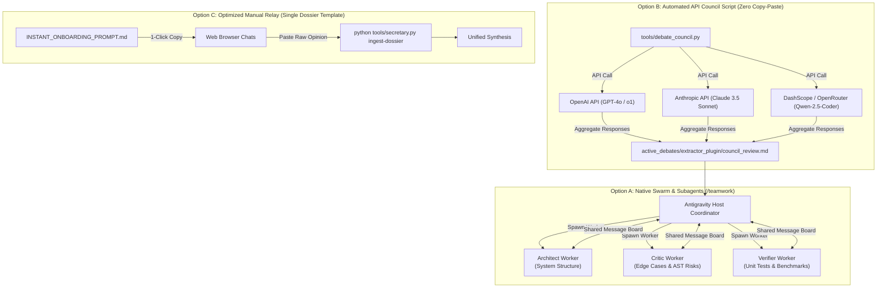

# Implementation Plan: Multi-AI Collaboration Workflow, Swarm Strategy & Master.db Management

## Goal Description
The purpose of this plan is to establish a rigorous, highly efficient workflow for multi-AI collaboration and architectural review, eliminate manual copy-pasting fatigue between web browser AI chats and Antigravity, explain and resolve the repository strategy for `master.db`, and define how to apply Antigravity's native `/boost` and `/teamwork` (Swarm) capabilities for the **Misora Extractor Plugin** development.

---

## User Review Required

> [!IMPORTANT]
> **Why `master.db` Was Excluded from the Git Repository:**
> 1. **Binary Size & Git History Bloat**: `master.db` is ~51.4 MB of binary SQLite 3 data. In Git, binary files cannot be diffed cleanly. Every weekly or bi-weekly game update synced from Robo Ninon creates a full new 50MB packfile in `.git/objects/`, causing the repository size to rapidly balloon into gigabytes and making `git clone` / `git fetch` unacceptably slow. GitHub also triggers warnings for files > 50MB and hard blocks files > 100MB.
> 2. **Copyright & TOS Compliance (DMCA Risk)**: `master.db` contains raw narrative scripts, unit parameters, voice audio cues, and copyrighted intellectual property of Cygames. Hosting it publicly on GitHub invites automated DMCA takedown notices.
> 3. **Dynamic Upstream Nature**: `master.db` is an upstream-generated database produced by Robo Ninon, not repository source code. Industry best practice treats large third-party databases as an **external local dependency** managed via automated download scripts.

> [!TIP]
> **Proposed Solution for `master.db`**:
> Implement an automated utility script `tools/sync_master_db.py` that checks the remote ETag/HEAD at `https://roboninon.win/db/download`, downloads the fresh database into local storage (or links to `D:\Kyouka-Asset-Explorer\master.db`), and keeps it strictly ignored via `.gitignore`.

---

## 1. Deep Dive: Multi-AI Debate Protocols & Efficient Workflows

### The Friction in Current Manual Web-Relay Workflow
Currently, your workflow requires:
1. Opening multiple web browser tabs (ChatGPT, Claude, Gemini, Qwen).
2. Manually copying prompts, repository links, and context.
3. Reading multiple essay-length responses across tabs.
4. Manually summarizing and ferrying consensus back to Antigravity.
5. Risk: High cognitive fatigue, context drift, hallucinations (since web AIs cannot inspect local files or run test runners).

### Proposed 3-Tier Multi-AI Collaboration Hierarchy

---

## 2. Analysis of Slash Commands: `/boost` vs `/teamwork`

| Command | Mechanism & Internal Behavior | Best Fit in Misora Project |
| :--- | :--- | :--- |
| **`/boost`** | Triggers deep, multi-perspective chain-of-thought, structural risk assessment, and rigorous verification before taking action. The model self-interrogates: *"What could break? How will Tkinter thread safety be impacted? What are the edge cases in FlatBuffer parsing?"* | **Use when designing complex single components** (e.g. designing the CSIF memory bridge or writing Tkinter background threading in `Misora-Editor`). |
| **`/teamwork`** | Launches Antigravity's **Swarm Architecture** (`swarm` tool). Spawns multiple autonomous worker agents on a shared message board with specialized briefs (e.g., Worker 1: `cache_scanner`, Worker 2: `flatbuffer_codec`, Worker 3: `sqlite_metadata`). Workers report findings, cross-review code, and collaborate in parallel. | **Use when tackling broad multi-module milestones** (e.g. simultaneously building the UI modal, the backend codec, and the unit test suite). |

---

## Proposed Changes

### Component 1: `master.db` Automated Sync & Git Guard
Protect the repository from accidental large file commits and provide an automated sync utility.

#### [NEW] `tools/sync_master_db.py`
A lightweight, resilient CLI utility that:
- Checks if local `master.db` exists in `D:\Kyouka-Asset-Explorer\master.db` or local directory.
- Queries `https://roboninon.win/db/download` using HTTP HEAD / ETag / Content-Length to determine if an upstream update exists.
- Downloads and unpacks the fresh SQLite 3 database safely with progress display.
- Verifies database integrity via `PRAGMA integrity_check;`.

#### [NEW] `.gitignore`
Ensures `.db`, `.sqlite`, `.unity3d`, `__pycache__`, and temporary test artifacts never pollute git history.

---

### Component 2: Multi-AI Debate Council Automation

#### [NEW] `tools/debate_council.py` (Optional API Runner)
If API keys (such as `OPENAI_API_KEY`, `ANTHROPIC_API_KEY`, or `OPENROUTER_API_KEY`) are present in the environment:
- Sends `active_debates/extractor_plugin/01_KICKOFF_BRIEFING_EXTRACTOR_PLUGIN.md` in parallel to external models.
- Records structured feedback directly into `active_debates/extractor_plugin/council_dossier.md`.
- Completely removes the need for manual copy-pasting across browser windows.

#### [NEW] `tools/secretary.py` (Dossier Ingest Extension)
If manual web browsers are still preferred:
- Adds command `python tools/secretary.py record-dossier --ai [gpt|claude|qwen] --file response.txt`.
- Automatically formats and appends the critique to the active debate log without manual markdown editing.

---

### Component 3: Swarm Configuration for Extractor Plugin

#### [NEW] `active_debates/extractor_plugin/SWARM_ROSTER.md`
Defines the specialized worker agent briefs for `/teamwork`:
1. **`worker-architect`**: Focuses on `plugins/datamine_extractor/` API contracts and `StoryAST` integration in `Misora-Editor`.
2. **`worker-codec`**: Focuses on memory-stream FlatBuffer parsing and `_invert_every_third_byte` optimization.
3. **`worker-verifier`**: Focuses on mock test bundles, boundary cases, and performance benchmarking (< 1ms).

---

## Verification Plan

### Automated Tests
1. Run `python tools/sync_master_db.py --check-only` to verify remote Robo Ninon connectivity and local path detection.
2. Run `python -m unittest tests/test_extractor_prototype.py` to confirm 100% pass on all 9 unit tests.
3. Verify git cleanliness: `git status` confirms zero binary `.db` files staged.

### Manual Verification
1. User tests running `python tools/sync_master_db.py` to observe automatic database synchronization.
2. User reviews `SWARM_ROSTER.md` and decides whether to trigger native `/teamwork` or run the API council script.
