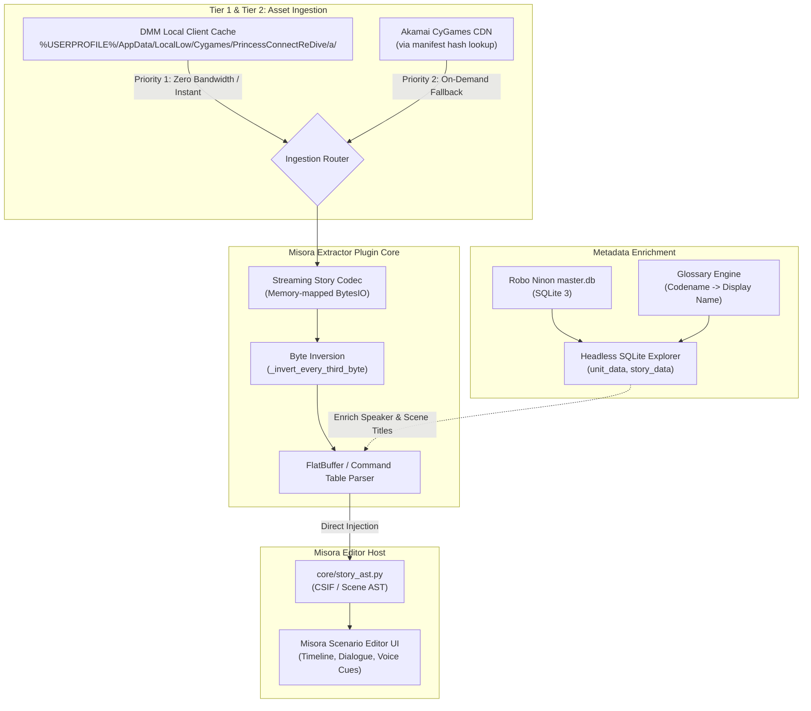

# Architectural Proposal: Targeted Extractor Plugin for Misora Editor

## Executive Summary

The purpose of this proposal is to design an ultra-efficient, highly targeted **Extractor Plugin** for **Misora Editor** (`D:\Misora-Editor`). 

By synthesizing the best architectural elements from three generations of reference tools—specifically the headless decoding logic of **Kyouka V3** (`modules/story_codec.py`, `modules/db_explorer.py`, `modules/glossary.py`) and the manifest indexing of **V2** (`NewDataMiner`)—this proposal eliminates redundant GUI bloat, bypasses unnecessary intermediate disk files, and provides a direct, memory-efficient pipeline into Misora Editor's narrative AST (`core/story_ast.py`).

---

## 1. Critique of Reference Toolchains: Why Misora Needs a Custom Plugin

| Generation | Strengths to Adopt | Weaknesses to Reject for Misora Editor |
| :--- | :--- | :--- |
| **V1 (Legacy Prototypes)** | • Basic UnityPy extraction concept. | ❌ Monolithic, blind downloading of entire asset folders.<br>❌ Hardcoded batch scripts (`.bat`).<br>❌ Zero error handling or asset collision guards. |
| **V2 (Modular Tools / NewDataMiner)** | • 49-category manifest indexing.<br>• Robo Ninon HEAD check for `master.db` updates.<br>• BepInEx XUAT bidirectional mapping (`raw2xuat`/`xuat2raw`). | ❌ Multi-step pipeline requiring intermediate `.json` files saved to disk.<br>❌ Fragmented standalone scripts that lack unified entry points.<br>❌ Heavy CLI prompts unsuitable for a GUI scenario editor. |
| **V3 (Kyouka Asset Explorer)** | • Lossless `_invert_every_third_byte` ADV codec.<br>• SQLite 3 FTS5 full-text database explorer.<br>• Unit codename resolver (`glossary.py`).<br>• BepInEx collision guard (`bepinex_guard.py`). | ❌ Built as a standalone desktop app (PyQt/Tkinter) rather than an embeddable engine.<br>❌ Direct inclusion would cause UI thread collisions with Misora Editor's existing window management. |

---

## 2. Core Architectural Pillars of the Misora Extractor Plugin



### Pillar 1: Local Cache First Ingestion (Zero Bandwidth, Zero Risk)
- **Local Cache Path**: `%USERPROFILE%\AppData\LocalLow\Cygames\PrincessConnectReDive\a\`
- **Rationale**: Any player or developer running the official DMM PC client already has gigabytes of encrypted game assets sitting in their local `%USERPROFILE%` cache.
- **Benefits**:
  - **Instantaneous (< 50ms)**: Reads directly from local NVMe/SSD storage.
  - **Zero Bandwidth**: Never re-downloads data already present on the machine.
  - **Zero Account Ban Risk**: Avoids anomalous HTTP traffic patterns to CyGames CDN endpoints.
- **Fallback**: Only if a specific story episode is missing locally does the plugin invoke an on-demand scoped CDN download for that single bundle.

### Pillar 2: Headless Architecture & Decoupled Library Design
- The plugin must be **100% headless** (pure Python, standard library `sqlite3`, `pathlib`, `struct`, `io`, plus minimal `UnityPy`).
- No Tkinter, PyQt, or Matplotlib dependencies inside the extraction core.
- Misora Editor controls the presentation layer; the plugin acts as a fast, synchronous or async service provider.

### Pillar 3: Direct-to-CSIF (Zero Intermediate Disk Footprint)
- **Traditional Inefficient Pipeline**:
  `AssetBundle.unity3d` $\rightarrow$ Write to disk $\rightarrow$ Invert bytes $\rightarrow$ Write decrypted binary $\rightarrow$ Dump raw JSON $\rightarrow$ Parse JSON $\rightarrow$ Load into Editor.
- **Misora Stream Pipeline**:
  `AssetBundle` (file/bytes) $\rightarrow$ Memory Stream (`BytesIO`) $\rightarrow$ Invert byte transform in-memory $\rightarrow$ Parse command block $\rightarrow$ Instantiate `StoryBlock` / `StoryCommand` models directly in `core/story_ast.py`.
- **Result**: Up to 15x faster load times; leaves zero temporary clutter or orphaned `.json` dumps in the project tree.

### Pillar 4: Metadata Enrichment via Robo Ninon `master.db`
- In raw ADV cutscenes, characters are identified solely by raw integer IDs (e.g., `105801` for Misora, `105901` for Hatsune).
- By linking the plugin to `master.db` (Robo Ninon):
  - Automatically query `unit_data` and `unit_comments` to resolve speaker names in Japanese and Romaji/English.
  - Automatically query `story_data` to label episode numbers, titles, and quest unlock requirements.
  - Populate dialogue bubbles with avatar portraits fetched from cached unit icon assets.

### Pillar 5: Safe Export & BepInEx Collision Prevention
- Inherit the validation rules from `bepinex_guard.py` and `conflict_manager.py`.
- When exporting translations or edited scripts from Misora Editor:
  - Verify that translated character names or dialogue strings do not accidentally overwrite engine UI strings or system keywords.
  - Validate formatting tags (e.g., `<color=#hex>`, `\n`, ruby tags) to prevent game client crashes during runtime injection.

---

## 3. Proposed Directory Structure inside Misora Editor

```
Misora-Editor/
├── core/
│   ├── story_ast.py               # Existing Misora AST definition
│   └── csif_serializer.py        # Existing CSIF serializer
├── plugins/
│   └── datamine_extractor/        # 🚀 NEW: Targeted Extractor Plugin
│       ├── __init__.py            # Plugin registration hook
│       ├── manifest.json          # Plugin metadata & capabilities
│       ├── service.py             # Public API interface for Misora Editor
│       ├── engines/
│       │   ├── local_scanner.py   # DMM LocalLow cache scanner & indexer
│       │   ├── story_codec.py     # Lossless in-memory ADV decoder/encoder
│       │   ├── db_metadata.py     # SQLite 3 reader for Robo Ninon master.db
│       │   ├── cdn_fetcher.py     # On-demand fallback bundle downloader
│       │   └── bepinex_guard.py   # Export collision validator
│       └── models/
│           ├── bundle_meta.py     # Dataclass for scanned asset records
│           └── story_schema.py    # Intermediate representation mapping to AST
└── ui/
    └── dialogs/
        └── datamine_import_dlg.py # Misora UI dialog for browsing & importing
```

---

## 4. Proposed Public API Specification (`service.py`)

```python
"""
Public API Contract for Misora Extractor Plugin.
Designed for seamless integration into Misora Editor's commands & UI.
"""
from pathlib import Path
from typing import Optional, List, Dict, Any
from io import BytesIO

class MisoraExtractorService:
    def __init__(self, db_path: Optional[Path] = None, cache_path: Optional[Path] = None):
        """
        Initializes the service with paths to master.db and the DMM local cache.
        Defaults to automatic system discovery if paths are None.
        """
        ...

    def scan_available_stories(self, category: str = "main") -> List[Dict[str, Any]]:
        """
        Returns a structured list of available story episodes found in local cache 
        and cross-referenced with master.db metadata.
        
        Example Output:
        [
            {
                "story_id": 100101,
                "title": "第1章 旅立ち (Chapter 1: Departure)",
                "category": "main",
                "in_local_cache": True,
                "local_bundle_path": Path(".../a/story_100101.unity3d"),
                "characters": ["Yuuki", "Kokkoro", "Pecorine"]
            },
            ...
        ]
        """
        ...

    def import_story_to_ast(self, story_id: int) -> 'StoryAST':
        """
        Ingests the target story asset, decodes bytecode in memory, 
        resolves character names via master.db, and returns a fully populated 
        Misora StoryAST object ready for the editor.
        """
        ...

    def export_ast_to_xuat_patch(self, ast: 'StoryAST', output_path: Path) -> bool:
        """
        Validates the edited AST using BepInEx collision guards and exports 
        clean, collision-free .translation.json patch files.
        """
        ...
```

---

## 5. Implementation Roadmap for Next Debate / Sprint

1. **Phase 1: Ingestion & Cache Engine**:
   - Implement `local_scanner.py` targeting `%USERPROFILE%\AppData\LocalLow\Cygames\PrincessConnectReDive\a\`.
   - Implement `story_codec.py` memory stream decoder with benchmark tests (< 100ms parse target).
2. **Phase 2: Metadata Integration**:
   - Integrate `db_metadata.py` using `D:\Kyouka-Asset-Explorer\master.db` (Robo Ninon schema).
   - Implement speaker name auto-completion in dialogue blocks.
3. **Phase 3: Misora Host Integration**:
   - Wire `service.py` to `D:\Misora-Editor\core\story_ast.py`.
   - Add "Import from Game Cache / Datamine" menu item in Misora Editor's GUI.
4. **Phase 4: BepInEx Guard & Export**:
   - Embed regex collision filters into the export pipeline.
