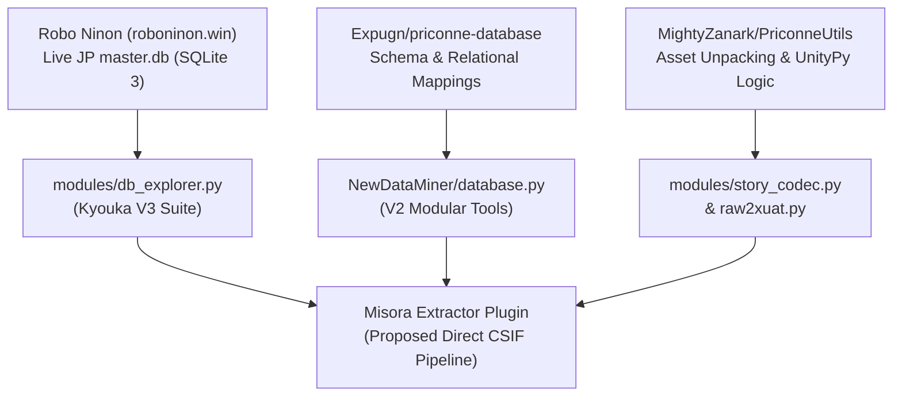

# Community Heritage & Source Registry

This document establishes the historical lineage, origin repositories, and upstream datamine sources for the Princess Connect! Re:Dive (Priconne JP) reverse engineering tools and database parsers utilized in the **Misora Reference** project.

---

## 1. Primary Datamine Source: Robo Ninon (`master.db`)

### Official Source
- **URL**: [https://roboninon.win/db/download](https://roboninon.win/db/download)
- **Database File**: `master.db` (Format: **SQLite 3**, uncompressed / unobfuscated)
- **Status**: **Actively Maintained & Automated** (Syncs with latest Princess Connect! Re:Dive JP game client updates)

### Clarification & Correction (Rectifying the `master.mdb` Misconception)
> [!IMPORTANT]
> **There is NO `master.mdb` in modern Princess Connect! Re:Dive JP.**
> In legacy forums or early hallucinated documentation, the file was occasionally misnamed `master.mdb` (evoking Microsoft Access). In reality, the official client encrypts/bundles an internal SQLite database named `master.db`. 
>
> The service at **Robo Ninon** (`roboninon.win`) decrypts, unpacks, and republishes this database directly as a standard, deobfuscated **SQLite 3 database (`master.db`)**.

### Scope & Structure of Robo Ninon's `master.db`
- **File Size**: Typically ~50 MB to 55 MB (uncompressed SQLite 3).
- **Table Count**: Over 900+ relational tables (e.g., `unit_data`, `unit_comments`, `story_data`, `quest_data`, `event_story_data`, `skill_data`).
- **Selective Filtering (Partial Category Datamine)**:
  Robo Ninon publishes a curated/filtered version optimized for community tools and battle/character calculators. While certain client-internal proprietary binary blobs or anti-cheat flags are excluded, it contains **100% of game-design and narrative-relevant metadata**:
  - Full character names, IDs, unit variants, and voice actor credits.
  - Story chapter listings, episode prerequisites, and dialogue index mappings.
  - Quest hierarchies, event IDs, banner metadata, and localized Japanese text strings.

---

## 2. Upstream Open-Source Projects & Community Heritage

The scripts and toolchains in this repository trace their design paradigms to foundational tools created by the Priconne reverse-engineering community:

### A. Expugn/priconne-database
- **Repository**: [https://github.com/Expugn/priconne-database](https://github.com/Expugn/priconne-database)
- **Role in Ecosystem**: 
  - Pioneered public documentation of the SQLite schema for Princess Connect! Re:Dive.
  - Provided scripts to parse SQLite tables into readable JSON, CSV, and markdown tables for wiki curation and damage calculation engines.
  - Established canonical table relationships between `unit_data`, `unit_skill_data`, and `skill_action`.
- **Current Status**: Historically influential; served as the baseline schema reference for `NewDataMiner` and `Kyouka-Asset-Explorer`.

### B. MightyZanark/PriconneUtils
- **Repository**: [https://github.com/MightyZanark/PriconneUtils](https://github.com/MightyZanark/PriconneUtils)
- **Role in Ecosystem**:
  - Provided practical Python utilities for decrypting and unpacking Priconne Unity asset bundles (`.unity3d`, FlatBuffers, texture atlas de-swizzling).
  - Documented asset manifest hash algorithms and CyGames CDN asset download conventions.
- **Current Status**: Semi-archived / infrequently updated, but its core bundle traversal and FlatBuffer decoding patterns formed the foundation for `priconne_tool(old).py` and `raw2xuat.py`.

---

## 3. Heritage Flow & Evolution in Misora Reference

---

## 4. Integration Guidelines for AI Agents & Developers

1. **Always Use SQLite 3 Driver**: Connect to `master.db` using Python's native `sqlite3` module. Never attempt to use MS Access ODBC or MDB drivers.
2. **Schema Invariance**: Table structures in `master.db` occasionally gain new columns during major game anniversaries (e.g., 6-star rank upgrades or new battle mechanics). Always query tables defensively using `PRAGMA table_info(table_name)` or named column indexing rather than positional tuples.
3. **Primary Key Conventions**:
   - `unit_id`: 6-digit integer (e.g., `105801` for Misora).
   - `story_id`: Compound integer encoding category, chapter, and episode.
   - `title`: UTF-8 Japanese string containing the in-game display title.
